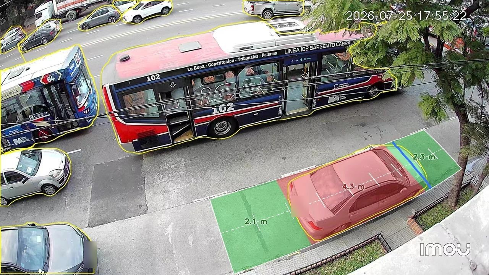

### Hi, I'm Luciano (Lulo) Stupnik 👋

I build AI that leaves the notebook and solves concrete problems: LLM agents, computer vision, and efficient inference on cheap hardware.
AI Engineer @ Loligo · Computer Engineering (5-yr engineering degree) @ ITBA · MSc exchange @ Politecnico di Milano · 🇦🇷 ES · EN · IT

---

#### 🚀 Featured

> 🔒 = private repo (co-authored or in-progress work). Happy to walk you through the code or give temporary read access, just ask.

| Project | What it is | Highlights |
|---|---|---|
| **estacionai** 🔒 | A street camera and a Raspberry Pi tell you when a parking spot opens on the block, and whether *your* car fits. Live, with Telegram alerts. Built with two friends. | YOLO11-seg on a GPU-less server: RAM ~915 → 350 MB, OpenVINO 1.8× faster, answers 2.5 s → 73 ms |
| **autonomous-devteam** 🔒 | A team of Claude Code agents (Product → Dev → QA → Reviewer) that works overnight on a real product in development, behind hard guardrails. | ~95 commits and 10 approved PRs in its first week; no credentials, a human merges every change |
| [**softmax**](https://github.com/lulostupnik/softmax) | Custom RISC-V instruction + functional unit in gem5 to accelerate int8 Softmax for Transformers on edge devices. PoliMi research project. | 21.6–35.7 % faster · graded 30/30 |
| [**TP2_SO**](https://github.com/lulostupnik/TP2_SO) | Preemptive x86-64 kernel from scratch: asm context switch, priority scheduler, buddy allocator, semaphores, pipes, shell. | ~7.2k lines of C/NASM · team of 3 |

  
   <b>EstacionAI</b> live: it segments every vehicle, measures the parked car (4.3 m) and the free gaps on the curb (2.1 m and 2.3 m). Image by Lorenzo; plates blurred.

<b>More</b>

- **orquesta** 🔒: KASZEK × Anthropic hackathon (selected among 200 out of 3,000+). AI agents that debate (defender vs. critic) to produce evidence-based performance reviews, streamed live.
- **placard** 🔒: my wardrobe across homes: snap a photo and the app detects, embeds and matches each garment (Grounding DINO · SigLIP · pgvector), with a voice and chat assistant. I use it daily.
- **TPE_ARQUI** 🔒: bare-metal x64 kernel with drivers and syscalls. I later spent a year as a TA for this course.

#### 🛠️ Stack

**AI:** LLM agents (Claude, OpenAI, LangGraph) · tool-calling, evals & human-in-the-loop · YOLO · OpenVINO · CLIP / SigLIP · pgvector · Whisper · PyTorch
**Software:** Python (FastAPI) · TypeScript (React, Next.js, Node) · Go · Java · PostgreSQL
**Infra:** AWS (EC2, ECS, SQS, RDS, S3) · Docker · Terraform/OpenTofu · GitHub Actions · Raspberry Pi
**Low level:** C · x86-64 & RISC-V assembly · gem5

#### 📫 Contact

[LinkedIn](https://www.linkedin.com/in/luciano-stupnik)
